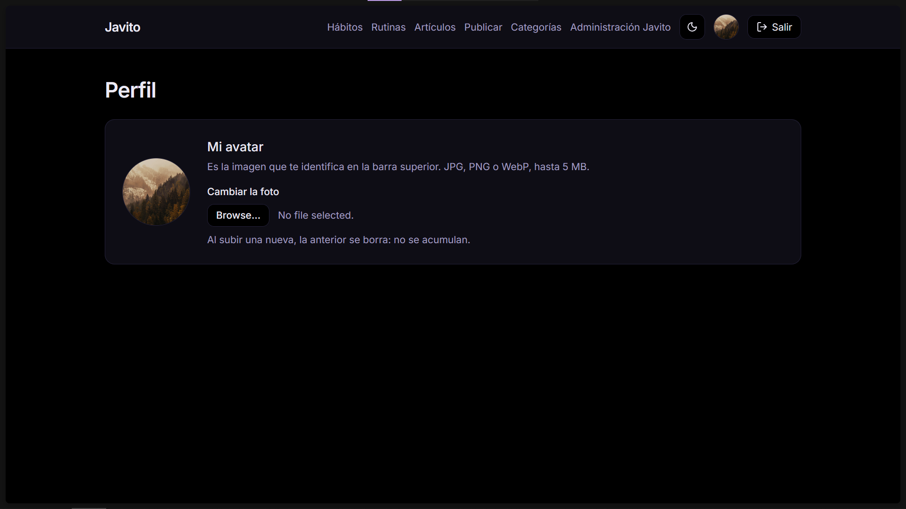
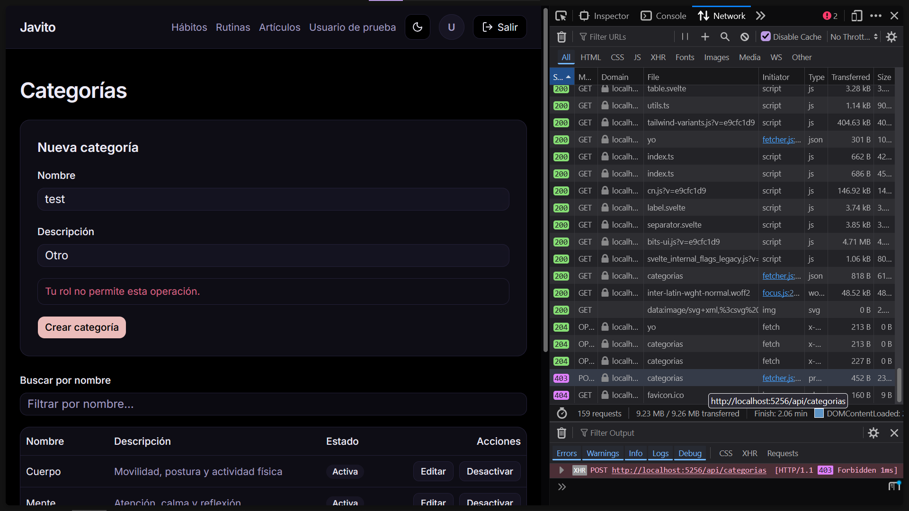
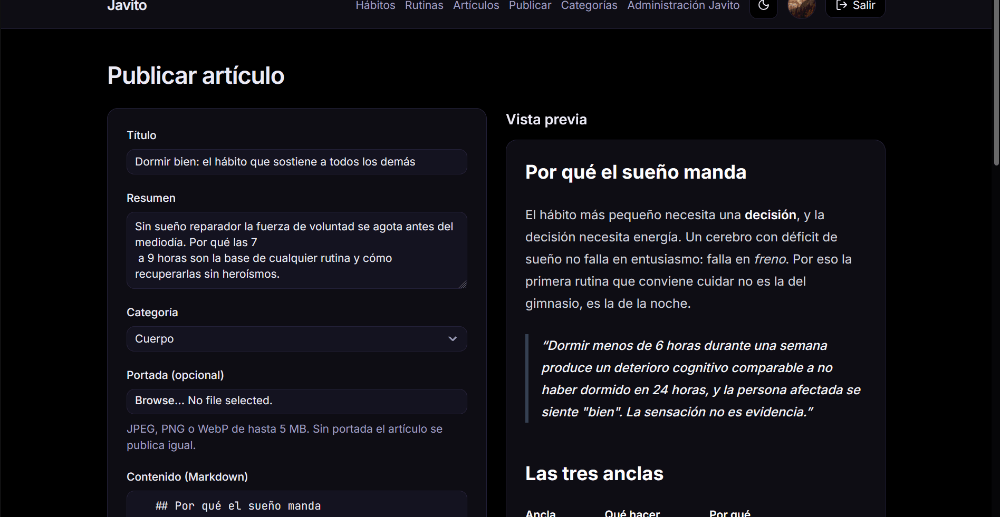
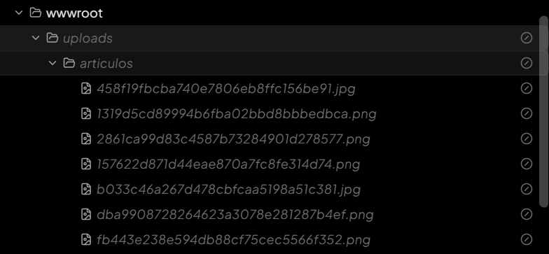
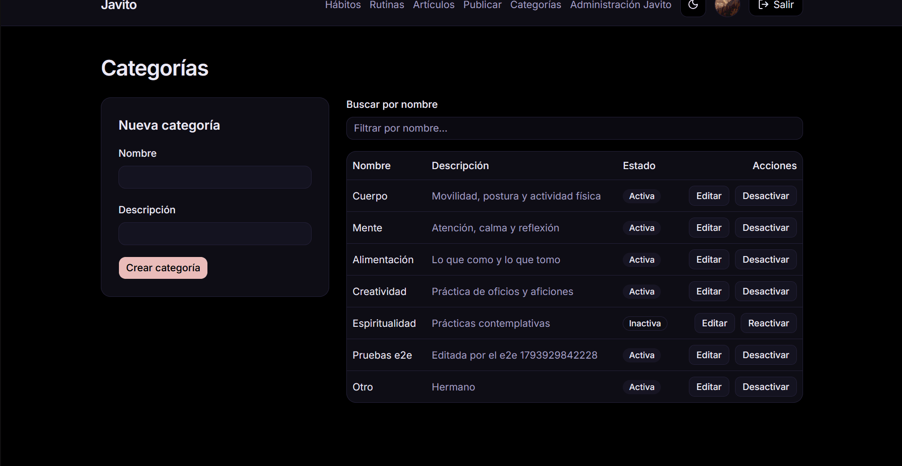
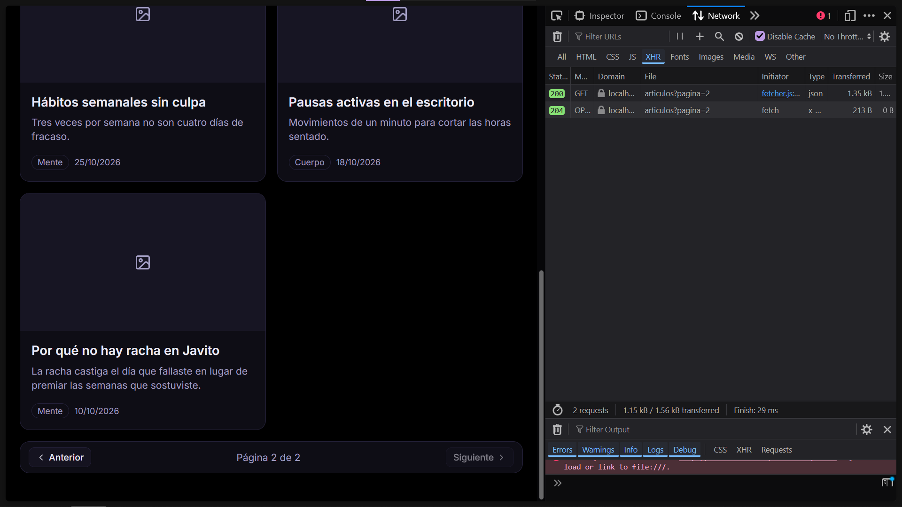
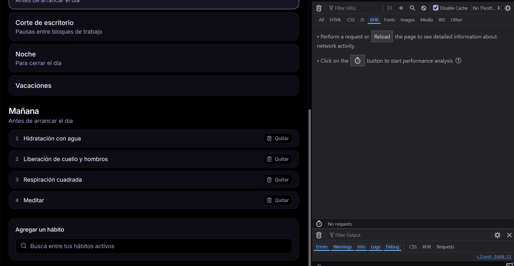
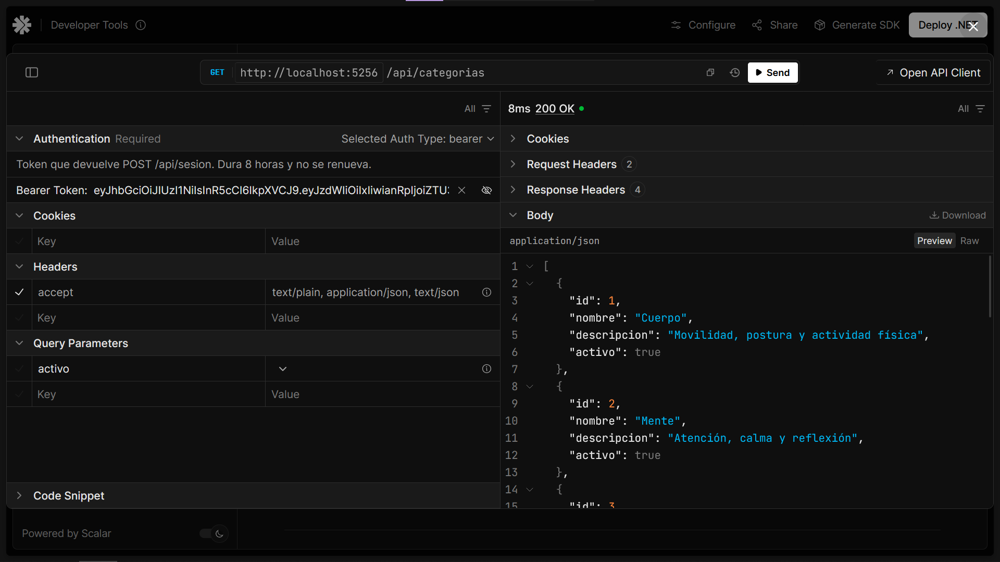
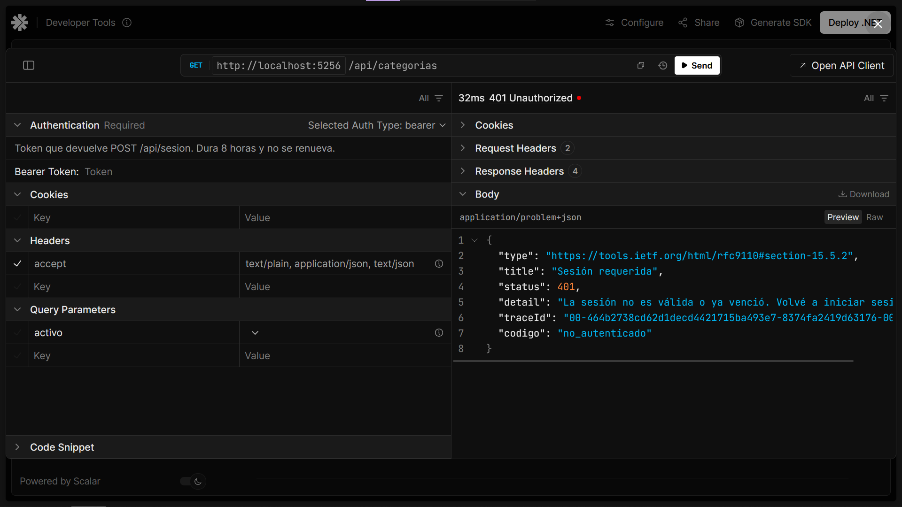

# Javito

Javito es una aplicación web para registrar hábitos diarios. Cada usuario crea sus hábitos, los marca día
a día desde la pantalla *Hoy* y ve la semana de cada uno de un vistazo; además puede agruparlos en rutinas.
El Administrador gestiona las categorías y publica artículos sobre ciencia del comportamiento con imagen de
portada, que todos leen en un catálogo paginado. Es una SPA en SvelteKit que consume una Web API REST en
ASP.NET Core con JWT, sobre MySQL.

Proyecto Integrador Final de **Laboratorio 2** (Desarrollo de Software Full Stack).
**Entrega: `2026-11-05`** · Modalidad individual · Angel Emanuel — emanuelangelsbr@gmail.com

---

## El problema que resuelve

El seguimiento de hábitos falla por problemas de las herramientas existentes:

1. **Fricción al registrar:** demasiados pasos y esperas para anotar una acción de dos segundos.
2. **Dependencia del celular:** casi todas son solo apps móviles, sin versión web para usar desde la computadora.
3. **Cobros excesivos:** suscripciones de USD 40–60 al año que bloquean funciones básicas (historial completo, más de 3 hábitos).
4. **Interfaces saturadas:** gamificación (vidas, oro, niveles) que distrae del objetivo.
5. **Falta de información:** casillas de verificación sin explicar cómo se arma y se sostiene un hábito.

### La propuesta

1. **Acceso web multiplataforma y responsivo:** funciona en cualquier navegador, sin instalar nada.
2. **Registro rápido y sin fricción:** botones de sí/no y contadores en la pantalla principal, guardado al instante sin recargar.
3. **Visualización clara de consistencia:** cuadrículas estilo contribuciones de GitHub, sin mecánicas de juego.
4. **Gratis y sin límites artificiales:** ni en cantidad de hábitos ni en historial.
5. **Módulo de educación:** artículos en Markdown sobre ciencia del comportamiento, con imagen de portada y gestión exclusiva del rol Administrador (cubre los requisitos de cátedra de manejo de archivos y funciones por rol).

---

## Matriz de Evidencias de Requerimientos Mínimos

Los enlaces apuntan a la línea exacta del código. Las evidencias son capturas y GIF de `docs/evidencias/`:
un clic en la miniatura la abre a tamaño completo. Además, los recorridos de `frontend/web/e2e/` reproducen
cada funcionalidad en el navegador con `pnpm test:e2e`.

| Requerimiento Mínimo | Estado | Enlace al Código / Controladores | Evidencia (Captura / GIF / Video) |
|---|---|---|---|
| 1. 7 tablas, relación 1:N y N:M | Cumplido | [database.sql#L101 (`rutina_habito`, N:M)](https://github.com/EmanuelAngel/javito/blob/1deda39438cc8cdbcc98aa5e60412f9d0cc9b822/database.sql#L101-L112) · [database.sql#L51 (`habito`, 1:N y dependiente de `usuario` + `categoria`)](https://github.com/EmanuelAngel/javito/blob/1deda39438cc8cdbcc98aa5e60412f9d0cc9b822/database.sql#L51-L68) | [DER en Mermaid](docs/proyecto/propuesta.md#21-diagrama-entidad-relación-der) |
| 2. Login, logout, roles y avatar | Cumplido | [SesionController.cs#L22 (login)](https://github.com/EmanuelAngel/javito/blob/1deda39438cc8cdbcc98aa5e60412f9d0cc9b822/backend/Javito.Api/Controllers/SesionController.cs#L22) · [sesion.svelte.ts#L91 (logout)](https://github.com/EmanuelAngel/javito/blob/1deda39438cc8cdbcc98aa5e60412f9d0cc9b822/frontend/web/src/lib/sesion.svelte.ts#L91) · [CategoriasController.cs#L31 (sólo Administrador)](https://github.com/EmanuelAngel/javito/blob/1deda39438cc8cdbcc98aa5e60412f9d0cc9b822/backend/Javito.Api/Controllers/CategoriasController.cs#L30-L31) · [ArticulosController.cs#L33 (sólo Administrador)](https://github.com/EmanuelAngel/javito/blob/1deda39438cc8cdbcc98aa5e60412f9d0cc9b822/backend/Javito.Api/Controllers/ArticulosController.cs#L32-L33) · [PerfilController.cs#L27 (avatar)](https://github.com/EmanuelAngel/javito/blob/1deda39438cc8cdbcc98aa5e60412f9d0cc9b822/backend/Javito.Api/Controllers/PerfilController.cs#L27) | <a href="docs/evidencias/02-perfil-avatar.png"></a> <a href="docs/evidencias/02-rol-403.png"></a><br>Avatar en la barra superior · un `Usuario` recibe 403 al crear una categoría |
| 3. Manejo de archivos (portada de artículo) | Cumplido | [ArticulosController.cs#L62](https://github.com/EmanuelAngel/javito/blob/1deda39438cc8cdbcc98aa5e60412f9d0cc9b822/backend/Javito.Api/Controllers/ArticulosController.cs#L62) · [AlmacenDeArchivosLocal.cs#L15](https://github.com/EmanuelAngel/javito/blob/1deda39438cc8cdbcc98aa5e60412f9d0cc9b822/backend/Javito.Api/Archivos/AlmacenDeArchivosLocal.cs#L15) · [FirmasDeImagen.cs (valida la firma, no la extensión)](https://github.com/EmanuelAngel/javito/blob/1deda39438cc8cdbcc98aa5e60412f9d0cc9b822/backend/Javito.Api/Archivos/FirmasDeImagen.cs) | <a href="docs/evidencias/03-portada-articulo.gif"></a> <a href="docs/evidencias/03-uploads.png"></a><br>Subida de la portada · el archivo en `wwwroot/uploads/articulos/` con nombre GUID |
| 4. ABM en SvelteKit + AJAX (categorías) | Cumplido | [CategoriasController.cs](https://github.com/EmanuelAngel/javito/blob/1deda39438cc8cdbcc98aa5e60412f9d0cc9b822/backend/Javito.Api/Controllers/CategoriasController.cs#L19-L106) · [admin/categorias/+page.svelte](https://github.com/EmanuelAngel/javito/blob/1deda39438cc8cdbcc98aa5e60412f9d0cc9b822/frontend/web/src/routes/(app)/admin/categorias/+page.svelte) · [api/categorias.ts](https://github.com/EmanuelAngel/javito/blob/1deda39438cc8cdbcc98aa5e60412f9d0cc9b822/frontend/web/src/lib/api/categorias.ts) | <a href="docs/evidencias/04-abm-categorias.gif"></a><br>Alta, edición, baja lógica y reactivación sin recargar |
| 5. Paginado por servidor (catálogo de artículos) | Cumplido | [ArticulosController.cs#L111](https://github.com/EmanuelAngel/javito/blob/1deda39438cc8cdbcc98aa5e60412f9d0cc9b822/backend/Javito.Api/Controllers/ArticulosController.cs#L111) · [ArticuloRepositorio.cs#L80 (`LIMIT`/`OFFSET`)](https://github.com/EmanuelAngel/javito/blob/1deda39438cc8cdbcc98aa5e60412f9d0cc9b822/backend/Javito.Api/Repositorios/ArticuloRepositorio.cs#L80) · [ParametrosDePagina.cs](https://github.com/EmanuelAngel/javito/blob/1deda39438cc8cdbcc98aa5e60412f9d0cc9b822/backend/Javito.Api/Paginacion/ParametrosDePagina.cs#L15) · [paginador.svelte](https://github.com/EmanuelAngel/javito/blob/1deda39438cc8cdbcc98aa5e60412f9d0cc9b822/frontend/web/src/lib/components/paginador.svelte) | <a href="docs/evidencias/05-paginado.png"></a><br>El pedido `?pagina=2` trae sólo esa página |
| 6. Selección asíncrona (hábitos de una rutina) | Cumplido | [HabitosController.cs#L32 (`?q=` en el servidor)](https://github.com/EmanuelAngel/javito/blob/1deda39438cc8cdbcc98aa5e60412f9d0cc9b822/backend/Javito.Api/Controllers/HabitosController.cs#L28-L40) · [buscador-de-habitos.svelte](https://github.com/EmanuelAngel/javito/blob/1deda39438cc8cdbcc98aa5e60412f9d0cc9b822/frontend/web/src/lib/components/buscador-de-habitos.svelte) · [busqueda.ts](https://github.com/EmanuelAngel/javito/blob/1deda39438cc8cdbcc98aa5e60412f9d0cc9b822/frontend/web/src/lib/busqueda.ts) | <a href="docs/evidencias/06-buscador.gif"></a><br>Un solo pedido `?q=` por búsqueda, no uno por tecla |
| 7. Web API + JWT | Cumplido | [Program.cs#L52 (`AddJwtBearer`)](https://github.com/EmanuelAngel/javito/blob/1deda39438cc8cdbcc98aa5e60412f9d0cc9b822/backend/Javito.Api/Program.cs#L52) · [ServicioDeTokens.cs#L14](https://github.com/EmanuelAngel/javito/blob/1deda39438cc8cdbcc98aa5e60412f9d0cc9b822/backend/Javito.Api/Seguridad/ServicioDeTokens.cs#L14) · [pedir.ts (manda el `Bearer`)](https://github.com/EmanuelAngel/javito/blob/1deda39438cc8cdbcc98aa5e60412f9d0cc9b822/frontend/web/src/lib/api/pedir.ts) | <a href="docs/evidencias/07-jwt-200.png"></a> <a href="docs/evidencias/07-jwt-401.png"></a><br>Con `Bearer` 200 · sin token 401. La SPA consume la API de forma nativa |

La metadata del paginado viaja en español (`pagina`, `tamanioDePagina`, `totalDeRegistros`,
`totalDePaginas`): es la misma que la consigna nombra `pageNumber`, `pageSize`, `totalRecords` y
`totalPages`.

### Requisitos adicionales para promocionar

- [x] `.gitignore` específico y sin artefactos de compilación
- [x] Diagrama Entidad-Relación adjunto ([DER en Mermaid](docs/proyecto/propuesta.md#21-diagrama-entidad-relación-der))
- [x] `README.md` con descripción y guía paso a paso
- [x] `database.sql` con estructura y datos de prueba precargados
- [x] Credenciales de prueba por rol
- [x] Colección de Postman/Bruno: no aplica, la SPA consume la Web API de forma nativa
- [x] Todo el proyecto corriendo en `localhost` sin errores (`pnpm check`: build, 142 pruebas del backend y `svelte-check` en verde)

---

## Stack

| Capa | Tecnología |
|---|---|
| Backend | ASP.NET Core WebAPI (.NET 10) |
| Frontend | SPA en SvelteKit (`adapter-static`) |
| Base de datos | MySQL 8.0 |
| Acceso a datos | ADO.NET puro (`MySqlConnector`, **sin ORM**) |
| Autenticación | JWT con roles (`Administrador`, `Usuario`) |
| Documentación de API | OpenAPI + Scalar |

---

## Estructura del repositorio

Monorepo: backend y frontend viven juntos porque forman una sola entrega y comparten el script de base de datos.

```
javito/
├── .editorconfig                     # LF e indentación (fuente de verdad de dotnet format)
├── .husky/                           # hooks: lint-staged y commitlint
├── .pi/mcp.json                      # MCP de Svelte del proyecto
├── AGENTS.md                         # convenciones para agentes
├── lint-staged.config.js             # reglas del hook pre-commit
├── package.json                      # tooling: commitlint, lint-staged, husky
├── backend/
│   ├── Javito.slnx                   # solución
│   ├── Javito.Api/                   # ASP.NET Core WebAPI (.NET 10)
│   │   ├── Controllers/              # endpoints REST
│   │   ├── Repositorios/             # SQL a mano con MySqlConnector
│   │   ├── Modelos/ Contratos/       # filas de la base y DTOs que viajan
│   │   ├── Seguridad/                # JWT y roles
│   │   ├── Archivos/                 # subida y validación de imágenes
│   │   └── Paginacion/               # parámetros y página del paginado por servidor
│   └── Javito.Api.Tests/             # pruebas del backend (xUnit)
├── frontend/
│   └── web/                          # SPA SvelteKit (adapter-static)
├── docs/                             # contexto, consignas, propuesta y DER
├── odd/tasks/                        # documentos de feature del trabajo trackeado
├── database.sql                      # estructura + datos de prueba
├── format-sql.sh                     # formateo de archivos .sql
└── README.md
```

> **Estado:** la fundación y el acceso están hechos: MySQL por ADO.NET, errores `ProblemDetails` con un
> `codigo` estable, JWT con guard en la SPA y shell autenticado. Sobre eso viven el ABM de categorías
> (sólo Administrador), el alta, la edición y el listado de hábitos, el día con sus marcas, el perfil
> con avatar, el catálogo de artículos (sólo Administrador para publicar) y las rutinas con su búsqueda
> asíncrona.
> La API expone `POST /api/sesion`, `GET /api/sesion/yo`, `GET|POST|PUT /api/categorias`,
> `GET|POST /api/habitos`, `PUT /api/habitos/{id}`, `PUT|DELETE /api/habitos/{id}/registros/{fecha}`,
> `GET /api/rutinas`, `GET|POST /api/rutinas/{id}`, `POST|DELETE /api/rutinas/{id}/habitos`,
> `GET /api/dias/{fecha}`, `POST /api/perfil/avatar`, `GET|POST /api/articulos`,
> `GET /api/articulos/{id}`, `GET /api/articulos/administracion`, `PUT /api/articulos/{id}/activo` y
> `GET /api/health`.
> El listado de hábitos acepta `q` (pedazo de título en un `LIKE` con los comodines escapados) y, con
> `q` dado, sólo devuelve hábitos activos: es el servidor adonde consulta el buscador de rutinas.
> Las convenciones de trabajo están en [AGENTS.md](AGENTS.md).

---

## Puesta en marcha

### Requisitos

| Herramienta | Versión verificada |
|---|---|
| .NET SDK | 10.0.302 |
| Node | 24.20.0 |
| pnpm | 10.26.1 |
| MySQL | 8.0.46 |

Los pasos van en este orden porque cada uno depende del anterior: la API no arranca sin los secretos y
necesita la base cargada, y el SPA necesita la API levantada. Todos los comandos se corren desde la raíz
del repositorio.

### 1. Dependencias

```sh
pnpm install
pnpm --dir frontend/web install
```

El primero instala las herramientas de la raíz (`commitlint`, `lint-staged`, `husky`) y activa los hooks
de Git; el segundo, las dependencias del SPA.

### 2. Base de datos

Con MySQL corriendo:

```sh
pnpm db:reset
```

Corre `mysql -u root -p < database.sql` y pide la contraseña de root. `database.sql` crea la base `javito`
**desde cero**: borra lo que hubiera y vuelve a cargar las 7 tablas con los datos de prueba.

El script arranca con `SET NAMES utf8mb4;` porque la terminal de Windows habla `cp850`: sin esa línea los
acentos se guardan corruptos. Las fechas de los registros son relativas al día en que se ejecuta, así que
la semana en curso siempre tiene datos.

### 3. Secretos

La contraseña de la base y la clave de los JWT viven fuera del repositorio, en `dotnet user-secrets`.
`ConnectionStrings:Javito` está en `backend/Javito.Api/appsettings.Development.json` **sin contraseña**;
la cadena completa se carga así:

```sh
dotnet user-secrets set "ConnectionStrings:Javito" "Server=localhost;Port=3306;Database=javito;User ID=root;Password=TU_CLAVE" --project backend/Javito.Api
dotnet user-secrets set "Jwt:Clave" "TU_CLAVE_DE_AL_MENOS_32_CARACTERES" --project backend/Javito.Api
```

Sin `Jwt:Clave` **la API no arranca**: falla al construirse, con un mensaje que dice cómo cargarla.
Necesita 32 caracteres o más.

### 4. Backend

```sh
pnpm dev:api
```

Queda escuchando en `http://localhost:5256`. Verificación:

```sh
curl http://localhost:5256/api/health
# {"estado":"ok","servicio":"Javito.Api","baseDeDatos":"ok"}
```

La documentación interactiva (Scalar) queda en `http://localhost:5256/scalar/v1`, y el documento OpenAPI
en `http://localhost:5256/openapi/v1.json`.

La sesión dura **8 horas y no se renueva**. Los endpoints de acceso son `POST /api/sesion` (login) y
`GET /api/sesion/yo` (quién soy, para validar la sesión al recargar). El resto exige
`Authorization: Bearer <token>`; sin él responde 401 con `codigo: "no_autenticado"`.

### 5. Frontend

```sh
pnpm dev:web
```

Queda en `http://localhost:5173`. Sin sesión, el SPA lleva a `/login`: se entra con cualquiera de los
[usuarios de prueba](#usuarios-de-prueba).

El backend habilita exactamente ese origen desde `Cors:AllowedOrigins`
(`backend/Javito.Api/appsettings.Development.json`). La política es **fail-closed**: sin orígenes
configurados no habilita ninguno. La URL de la API vive en un único lugar:
`frontend/web/src/lib/config.ts`.

La **primera visita a cada pantalla** en `pnpm dev:web` tarda más que las siguientes: Vite compila cada
módulo recién cuando se lo pide. Es un costo del servidor de desarrollo, no de la app; el build ya viene
compilado y no lo tiene. De la segunda visita en adelante, cada pantalla responde al instante.

### 6. Pruebas y formato

```sh
pnpm check       # dotnet build + dotnet test + svelte-check
pnpm test:web    # vitest
pnpm test:e2e    # recorridos de Playwright: levantan la API y el SPA por su cuenta
pnpm lint        # verifica el formato sin escribir
pnpm format      # aplica el formato
```

Las pruebas del backend usan un schema aparte, `javito_test`, que el fixture recrea en cada corrida: por
eso **`pnpm check` necesita MySQL prendido** y los secretos del paso 3. `pnpm test:e2e` necesita además
que no haya otra `Javito.Api` corriendo. El resto de los atajos está en `AGENTS.md`; `pnpm run` los lista.

> Con SvelteKit 3, `pnpm build:web` puede pasar con `pnpm check` en rojo. Corré los dos.

### Nota sobre el build estático

`pnpm --dir frontend/web build` genera la salida desplegable en `frontend/web/build/`, con `index.html`
como fallback de la SPA. `pnpm preview` **no** sirve esa carpeta: previsualiza `.svelte-kit/output/` y
resuelve el HTML por SSR, así que una ruta que todavía no existe devuelve 404. Para probar `build/` hace
falta un servidor estático que aplique la regla de fallback; en desarrollo, `pnpm dev` ya maneja el ruteo
del cliente.

---

## Usuarios de prueba

Vienen cargados en `database.sql`, con la contraseña **`Javito2026`** para los cuatro.

| Email | Rol | Estado |
|---|---|---|
| `admin@javito.local` | `Administrador` | Activo |
| `usuario@javito.local` | `Usuario` | Activo, con los 14 hábitos reales y sus registros |
| `otra@javito.local` | `Usuario` | Activo, para comprobar que nadie ve datos ajenos |
| `desactivado@javito.local` | `Usuario` | Inactivo: no puede iniciar sesión |

Las contraseñas están guardadas como hash bcrypt. El login (`POST /api/sesion`) las verifica y devuelve
un JWT con el rol del usuario.

---

## Modelo de datos (7 tablas)

`Usuario` · `Categoria` · `Habito` · `RegistroHabito` · `Rutina` · `RutinaHabito` · `Articulo`

El rol del usuario **no vive en una tabla**: `usuario.rol` es un `ENUM('Administrador', 'Usuario')`.

- Relación **1:N**: `Usuario` → `Habito`, `Usuario` → `Articulo`, `Habito` → `RegistroHabito`.
- Relación **N:M**: `Rutina` ↔ `Habito` mediante `RutinaHabito` (con orden de ejecución).
- `Articulo` y `Habito` dependen de dos tablas (`Usuario` + `Categoria`).
- Restricción `UNIQUE(habito_id, fecha)` en `RegistroHabito`: un registro por hábito por día. La meta se
  congela en el registro para no reescribir el historial si el usuario cambia su meta después.

El DER completo está en [docs/proyecto/propuesta.md](docs/proyecto/propuesta.md#21-diagrama-entidad-relación-der).

---

## Alcance y límite

**Alcance:** autenticación y sesiones · usuarios · categorías · hábitos · rutinas · registros diarios ·
artículos · cuadrícula de consistencia · paginado y búsqueda asíncrona.

**Límite:** no es offline ni app móvil nativa · sin integración con calendarios externos · sin
notificaciones push ni temporizadores en tiempo real · requiere conexión a internet.

---

## Estado del proyecto

| Hito | Estado |
|---|---|
| Propuesta aprobada por la cátedra | Cumplido |
| Repositorio y contexto documental | Cumplido |
| Scaffold del monorepo | Cumplido |
| Base de datos con datos de prueba (`database.sql`) | Cumplido |
| Los 7 requerimientos mínimos de la consigna | Cumplido |

## Documentación

- [Índice de documentación](docs/README.md)
- [Propuesta completa (aprobada)](docs/proyecto/propuesta.md)
- [Historias de usuario](docs/proyecto/historias-de-usuario.md)
- [Consigna final de la cátedra](docs/consignas/consigna-final.md)
- [Especificación consolidada y criterios acordados](docs/consignas/consigna-y-definiciones.md)

---

## Herramientas del repositorio

| Script | Uso |
|---|---|
| `./format-sql.sh [archivo]` | Formatea archivos `.sql` con `sql-formatter` |

Convención de commits: Conventional Commits en español, verbo en infinitivo, minúsculas y sin punto final
(`feat(repo): agregar repositorio de hábitos`).
