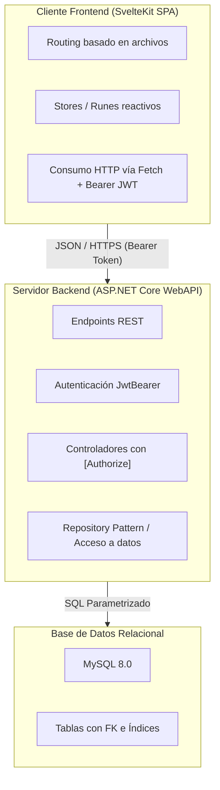

# Especificación Consolidada: Proyecto Propio Final

Documento base que unifica la consigna oficial de la cátedra con las aclaraciones, decisiones arquitectónicas y criterios acordados para la promoción.

> **Origen y reconciliación.** Este documento se redactó durante la etapa de propuesta, antes de que existiera
> Javito y antes de la consigna final. Donde se contradecía con la [consigna final](./consigna-final.md) o con la
> [propuesta aprobada](../proyecto/propuesta.md), manda lo indicado a continuación:
>
> | Punto | Decía | Vale |
> | :--- | :--- | :--- |
> | Cantidad de tablas | Mínimo 4 | **Mínimo 6** (consigna final). Javito define **8**. |
> | Nombres de rol | `Admin`, `Operador` | **`Administrador`, `Usuario`** (propuesta aprobada). |
> | Fecha de entrega | 06/11/2026 | **`2026-11-05`**. |

---

## 1. Resumen Ejecutivo

| Parámetro | Definición |
|---|---|
| **Modalidad** | Individual (Emanuel Angel) |
| **Backend** | ASP.NET Core WebAPI (.NET 10) |
| **Frontend** | SPA desacoplada en SvelteKit (modo cliente / `adapter-static`) |
| **Autenticación** | JWT (JSON Web Tokens) como mecanismo único (WebAPI + SPA) |
| **Dominio** | Ficticio/modelado permitido (no requiere cliente real). Javito: 7 tablas; el rol no se guarda en tabla. |
| **Evaluación** | Ejecución en `localhost` (sin deploy cloud) + defensa técnica oral (~20 min) |
| **Fecha de entrega** | 05/11/2026 (confirmada por la cátedra) |

---

## 2. Requerimientos Mínimos de la Cátedra y Decisiones Acordadas

| Requerimiento Cátedra | Detalle de la Consigna | Decisión / Criterio Acordado |
|---|---|---|
| **Tablas / Clases** | Mínimo 6 clases/tablas relacionadas, con al menos una relación 1:N y una N:M. | 7 tablas: `Usuario`, `Categoria`, `Habito`, `RegistroHabito`, `Rutina`, `RutinaHabito`, `Articulo`. La N:M se resuelve con `RutinaHabito`. El rol se representa con un ENUM o constantes estáticas, a definir. |
| **Seguridad y Roles** | Login con roles, uso de `[Authorize]`, funciones restringidas por rol y avatar de usuario. | Auth basada en JWT. Endpoints protegidos por roles (`Administrador`, `Usuario`). Subida y servicio de avatar con validación. |
| **Manejo de Archivos** | Uso de archivos adicional al avatar. | Imagen de portada de los artículos de divulgación (`Articulo.imagen_portada_url`), de carga exclusiva del Administrador. |
| **Frontend / AJAX** | Al menos un CRUD con framework frontend y toda la funcionalidad vía AJAX. | **100% SPA desacoplada**: toda la aplicación consumirá la WebAPI vía peticiones HTTP asíncronas con SvelteKit. |
| **Paginación** | Servir cada página por petición desde el servidor (no traer todo y paginar en cliente). | Paginación server-side con metadata (`pageNumber`, `pageSize`, `totalRecords`, `totalPages`). |
| **Búsqueda Relacionada** | Selección de entidades vinculadas mediante búsqueda asíncrona (AJAX), sin listar todo. | Componente de búsqueda predictiva / autocompletado en cliente que consulta endpoint con filtro y paginado. |
| **Uso de API con JWT** | Consumo natural o colección para probar vía Postman/Thunder Client. | La SPA es el consumidor natural de la API; se proveerá además la colección exportada (Bruno/Postman) para evaluación independiente. |

---

## 3. Arquitectura del Sistema

---

## 4. Checklist de Entregables (Criterios de Promoción)

Para acceder a la promoción directa, el repositorio debe contener:

- [ ] `.gitignore` específico y limpio (sin artefactos de compilación `bin/`, `obj/`, `.svelte-kit/`, `node_modules/`).
- [ ] Diagrama de Entidad-Relación (DER) o diagrama de clases.
- [ ] `README.md` completo con descripción del proyecto y guía paso a paso para levantar backend, frontend y BD.
- [ ] Sección en `README.md` o archivo de mapeo detallando la ubicación exacta en el código de cada requerimiento mínimo.
- [ ] Script SQL de inicialización con estructura y datos semilla listos para probar (`database.sql`).
- [ ] Credenciales de usuarios de prueba preconfigurados para cada rol del sistema.
- [ ] Colección exportada de Postman / Thunder Client para auditar todos los endpoints con JWT.
