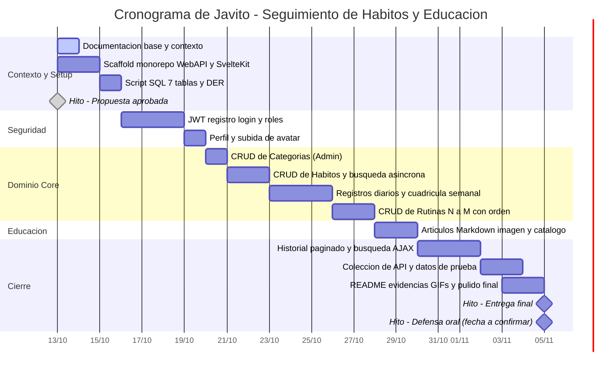

# Cronograma del Proyecto

Planificación de Javito entre el inicio del desarrollo y la entrega final.

- **Inicio:** `2026-10-13` (martes)
- **Entrega:** `2026-11-05` (jueves)
- **Duración:** 24 días corridos · **Margen libre: 0 días** (ver [Riesgo de cronograma](#riesgo-de-cronograma))

> **Convención del diagrama.** Mermaid calcula la duración de una tarea como la diferencia entre la fecha
> final y la inicial, por lo que la fecha final se escribe **un día después del último día de trabajo**.
> Un rango `2026-10-13, 2026-10-15` son **2 días**: el 13 y el 14. La columna *Días* de la tabla de
> referencia es la duración real, y es la que manda si hay diferencias.
>
> **Cuidado con los dos puntos.** `:` separa el nombre de la tarea de sus datos en la sintaxis de Mermaid.
> Un nombre con `:` adentro (por ejemplo `Rutinas N:M`) hace que Mermaid **descarte la tarea en silencio**:
> no hay error de sintaxis, la fase simplemente desaparece del diagrama. Por eso `S8` se llama *N a M*.
> Si editás este archivo, revisá que la cantidad de tareas siga siendo 13.

## Referencias de Fases y Entregables

| ID | Actividad | Desde (incl.) | Hasta (incl.) | Días | Entregable |
| :--- | :--- | :--- | :--- | :--- | :--- |
| **S0** | Documentación base y contexto | `2026-10-13` | `2026-10-13` | 1 | `README.md`, `docs/` completo y cronograma. Corre **en paralelo** con S1. |
| **S1** | Scaffold del monorepo | `2026-10-13` | `2026-10-14` | 2 | `backend/` (WebAPI .NET 10 con OpenAPI), `frontend/` (SvelteKit `adapter-static`), `.gitignore`, repo Git inicializado. |
| **S2** | Script SQL y DER | `2026-10-15` | `2026-10-15` | 1 | `database.sql` con las 7 tablas (FK, índices, `UNIQUE(habito_id, fecha)`) y el DER en Mermaid + imagen. |
| **S3** | Autenticación y roles | `2026-10-16` | `2026-10-18` | 3 | Registro, login/logout con JWT, roles `Administrador`/`Usuario`, endpoints con `[Authorize]`. |
| **S4** | Perfil y avatar | `2026-10-19` | `2026-10-19` | 1 | Edición de perfil y subida de avatar con validación de archivos. |
| **S5** | CRUD de Categorías (Admin) | `2026-10-20` | `2026-10-20` | 1 | ABM completo solo Administrador, con paginado server-side. |
| **S6** | CRUD de Hábitos | `2026-10-21` | `2026-10-22` | 2 | ABM, archivado (baja lógica), listado por usuario y búsqueda asíncrona de categorías. |
| **S7** | Registros diarios y cuadrícula | `2026-10-23` | `2026-10-25` | 3 | Marcado rápido del día (sí/no, contador, abstinencia) y cuadrícula de los últimos 7 días. |
| **S8** | CRUD de Rutinas (N:M) | `2026-10-26` | `2026-10-27` | 2 | ABM de rutinas con orden de hábitos y filtrado en la pantalla principal. |
| **S9** | Artículos | `2026-10-28` | `2026-10-29` | 2 | Editor Markdown, subida de imagen de portada (Admin) y catálogo paginado de lectura. |
| **S10** | Historial y búsqueda | `2026-10-30` | `2026-11-01` | 3 | Historial paginado de registros, vista histórica por hábito y búsqueda asíncrona. |
| **S11** | Datos de prueba y colección de API | `2026-11-02` | `2026-11-03` | 2 | `database.sql` con datos semilla, credenciales por rol y colección de Bruno/Postman. |
| **S12** | Evidencias y pulido | `2026-11-03` | `2026-11-04` | 2 | Matriz de evidencias completa, capturas y GIFs, correcciones finales. **Solapa un día con S11.** |
| **M0** | Propuesta aprobada por la cátedra | `2026-10-13` | — | — | Hito cumplido: propuesta validada. |
| **M1** | Entrega final | `2026-11-05` | — | — | Repo público con todo lo requerido para promocionar. |
| **M2** | Defensa oral | `2026-11-05` | — | — | Producto andando en `localhost` + entrevista técnica (~20 min). Fecha exacta a confirmar por la cátedra. |

## Riesgo de cronograma

Lo que hay que tener a la vista antes de confiar en estas fechas:

1. **Sin días libres.** Las 24 jornadas incluyen fines de semana y feriados. No hay tarea que contemple descanso.
2. **Cero margen.** El buffer original de imprevistos desapareció: el `05/11` es el día de entrega, no un colchón.
   Cada día perdido corre todo lo que sigue, porque las tareas son secuenciales.
3. **Documentación sin asignar.** `S0` cubre el contexto y el README, pero queda documentación de
   proyecto sin tarea propia ni días reservados.
4. **Solo `S12` es paralelizable** con `S11`, y es trabajo de cierre que también depende de que el resto funcione.
5. **Alcance grande para el tiempo disponible:** 7 tablas, 7 ABMs, subida de archivos con validación,
   paginado server-side y la SPA completa.

## Ajustes pendientes de decidir

El cronograma **no es definitivo**. Las tres salidas posibles:

| Opción | Qué implica | Costo |
| :--- | :--- | :--- |
| **A — Recortar alcance** | Diferir `S8` (Rutinas con N:M) o la vista histórica de `S10`, y cubrir el requisito de N:M con la tabla intermedia en otro ABM. Libera 2–3 días. | Menos funcionalidad, pero la relación N:M sigue cumpliendo el requisito de cátedra. |
| **B — Paralelizar por feature** | Backend y frontend del mismo módulo juntos, en lugar de todo el backend primero. | Requiere tener el contrato de API cerrado de antemano. |
| **C — Congelar el alcance antes** | Dejar el desarrollo congelado el `2026-11-03` y reservar `04/11` y `05/11` para datos de prueba, evidencias y defensa. | El cierre deja de ser una tarea y pasa a ser el margen real. |

Decisión sugerida: **C**, y si `S11` no está verde al `2026-11-02`, activar **A** recortando `S8`.
