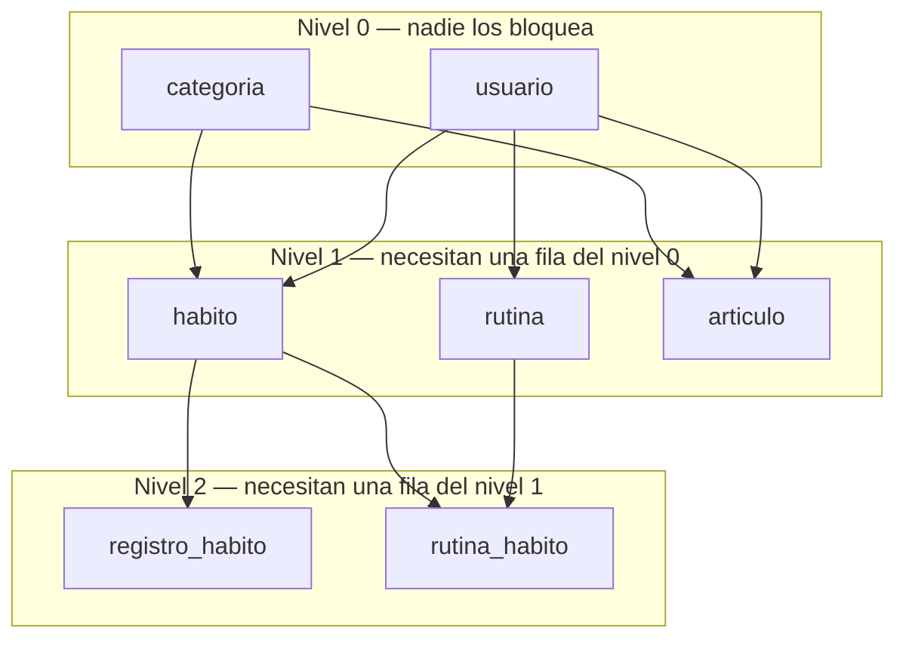
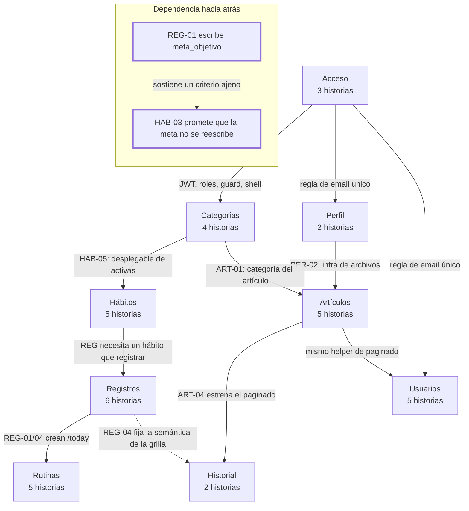
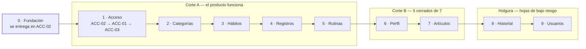
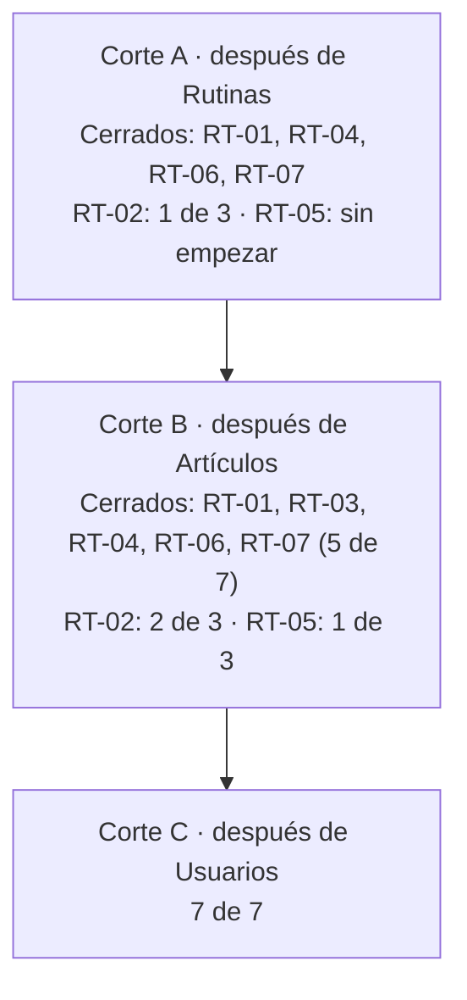

# Orden de implementación

El **cuándo** de las historias: qué módulo se encara antes y qué lo bloquea. Este documento no agrega
requisitos; **ordena** los de [historias-de-usuario.md](./historias-de-usuario.md) por dependencia real
y no por el orden narrativo en que están escritos. Es la fuente de verdad del orden de encare, y reemplaza
a la decisión #6 de ese documento.

Se usa al derivar una historia a issue: cada issue nombra la historia de la que depende (`Requiere:
HU-CAT-01`). Si un issue no puede cerrarse porque su predecesora no existe, el orden es el que está mal,
no el issue.

Este documento responde una sola pregunta operativa —**qué se hace ahora**— en §1, con las 37 historias
en secuencia. Todo lo que sigue explica por qué ese orden y no otro, y dónde conviene cortar si el
tiempo se acaba.

---

## 1. La secuencia

Las 37 historias, en el orden en que se encaran. **La columna `Cierra` es lo que hay que poder mostrar
en la defensa**; el resto de las historias son producto, no evidencia.

Regla de lectura: dentro de un módulo el orden es el del documento de historias, con **una sola
excepción: en Acceso el login va primero** (§5 lo explica). La columna `Requiere` no es una preferencia,
es una condición: si el renglón que nombra no está cerrado, este tampoco se puede cerrar.

| # | Historia | Módulo | Requiere | Cierra |
| --: | :--- | :--- | :--- | :--- |
| 1 | `HU-ACC-02` — Iniciar sesión | Acceso | — · **incluye la Fundación** | `RT-07` · `RT-02` (1 de 3) |
| 2 | `HU-ACC-01` — Registrarme | Acceso | `ACC-02` | — |
| 3 | `HU-ACC-03` — Cerrar sesión | Acceso | `ACC-02` | — |
| 4 | `HU-CAT-01` — Ver el listado de categorías | Categorías | `ACC-02` (rol) | — |
| 5 | `HU-CAT-02` — Crear una categoría | Categorías | `CAT-01` | — |
| 6 | `HU-CAT-03` — Editar una categoría | Categorías | `CAT-02` | — |
| 7 | `HU-CAT-04` — Desactivar y reactivar una categoría | Categorías | `CAT-03` | `RT-04` |
| 8 | `HU-HAB-01` — Crear un hábito | Hábitos | `ACC-02` | — |
| 9 | `HU-HAB-02` — Ver mis hábitos | Hábitos | `HAB-01` | — |
| 10 | `HU-HAB-03` — Editar un hábito | Hábitos | `HAB-02` | — |
| 11 | `HU-HAB-04` — Archivar y reactivar un hábito | Hábitos | `HAB-03` | — |
| 12 | `HU-HAB-05` — Elegir la categoría de un hábito | Hábitos | `HAB-01`, `CAT-02` | — |
| 13 | `HU-REG-01` — Marcar el día | Registros | `HAB-01` | — |
| 14 | `HU-REG-02` — Deshacer el día | Registros | `REG-01` | — |
| 15 | `HU-REG-03` — Corregir un día pasado | Registros | `REG-01` | — |
| 16 | `HU-REG-04` — Ver la semana de un vistazo | Registros | `REG-01` | — |
| 17 | `HU-REG-05` — Anotar una nota del día | Registros | `REG-01` | — |
| 18 | `HU-REG-06` — Cumplir un hábito que no es diario | Registros | `REG-01`, `REG-04` | — |
| 19 | `HU-RUT-01` — Crear una rutina | Rutinas | `ACC-02` | — |
| 20 | `HU-RUT-02` — Agregar hábitos a una rutina | Rutinas | `RUT-01`, `HAB-01` | `RT-01`, `RT-06` |
| 21 | `HU-RUT-03` — Ordenar los hábitos de una rutina | Rutinas | `RUT-02` | — |
| 22 | `HU-RUT-04` — Filtrar mi día por rutina | Rutinas | `RUT-01`, `REG-01` | — |
| 23 | `HU-RUT-05` — Editar y desactivar una rutina | Rutinas | `RUT-01` | — |
| 24 | `HU-PER-01` — Ver y editar mis datos | Perfil | `ACC-02`, `ACC-01` | — |
| 25 | `HU-PER-02` — Subir mi avatar | Perfil | `PER-01` · **estrena archivos** | `RT-02` (2 de 3) |
| 26 | `HU-ART-01` — Publicar un artículo | Artículos | `PER-02`, `CAT-02` | `RT-03` |
| 27 | `HU-ART-02` — Editar un artículo | Artículos | `ART-01` | `RT-03` |
| 28 | `HU-ART-03` — Desactivar un artículo | Artículos | `ART-02` | — |
| 29 | `HU-ART-04` — Ver el catálogo de artículos | Artículos | `ART-01` · **estrena paginado** | `RT-05` (1 de 3) |
| 30 | `HU-ART-05` — Leer un artículo | Artículos | `ART-04` | — |
| 31 | `HU-HIS-01` — Ver mi historial de registros | Historial | `REG-01`, `ART-04` | `RT-05` (2 de 3) |
| 32 | `HU-HIS-02` — Ver el detalle histórico de un hábito | Historial | `HIS-01` | — |
| 33 | `HU-USU-01` — Ver el listado de usuarios | Usuarios | `ACC-02`, `ART-04` | `RT-05` (3 de 3) → **cierra `RT-05`** |
| 34 | `HU-USU-02` — Crear un usuario | Usuarios | `USU-01`, `ACC-01` | — |
| 35 | `HU-USU-03` — Editar los datos de un usuario | Usuarios | `USU-01` | — |
| 36 | `HU-USU-04` — Cambiar el rol de un usuario | Usuarios | `USU-03` | `RT-02` (3 de 3) → **cierra `RT-02`** |
| 37 | `HU-USU-05` — Activar y desactivar un usuario | Usuarios | `USU-01` | — |

Tres cosas que esta tabla muestra y la prosa de los módulos no:

- **`HAB-01` no requiere una categoría.** `habito.categoria_id` es `NULL` a propósito (`HU-HAB-05`
  permite no elegir), así que Hábitos arranca sin esperar a Categorías. Lo que sí exige una categoría es
  `HU-ART-01`: `articulo.categoria_id` es `NOT NULL`.
- **`RT-05` se cierra en el renglón 33, no antes.** Los tres paginados son `ART-04`, `HIS-01` y `USU-01`;
  con el primero se cubre el mínimo de cátedra, pero el requisito no está cerrado.
- **`RT-02` se cierra en el renglón 36**, con el cambio de rol. Es el requisito que más tarde se cierra y
  no tiene atajo: los otros dos tercios son `ACC-02` (renglón 1) y `PER-02` (renglón 25).

---

## 2. Lo que hay que decidir antes del renglón 13

No bloquea el arranque, pero se cierra en el documento de feature de `REG` —**antes de escribir la
primera prueba de `REG-01`**, no después—. Son las dos únicas decisiones que pueden invalidar trabajo ya
hecho:

1. **Qué hace "reiniciar el día"** (`HU-REG-02`). El criterio dice "vuelve a cero y queda sin completar",
   pero `HU-REG-05` dice que la nota sobrevive. `database.sql` ya muestra el camino elegido: la fila queda
   con `valor_alcanzado = 0`, `completado = FALSE` **y su nota**, en lugar de borrarse. Hay que confirmarlo
   antes de la primera prueba, porque `uq_registro_habito_fecha` impide tener dos filas del mismo día.
2. **La meta se copia, no se referencia.** `registro_habito.meta_objetivo` se escribe en el momento de
   registrar y no se vuelve a tocar. Es la decisión de `REG` que sostiene `HU-HAB-03`, y también la que
   hace que `HU-REG-06` (cumplir la cuota semanal) pueda contar semanas viejas sin recalcular nada.

---

## 3. Las dependencias que imponen las FK

| Nivel | Tablas | Qué significa para el orden |
| :--- | :--- | :--- |
| 0 | `usuario`, `categoria` | Ninguna otra se puede escribir sin estas dos filas. |
| 1 | `habito`, `rutina`, `articulo` | Tres ramas independientes entre sí que comparten nivel 0. |
| 2 | `registro_habito`, `rutina_habito` | Las dos últimas: viven de una fila del nivel 1. |

Solo con esto el orden sería: `usuario` y `categoria` primero, `registro_habito` y `rutina_habito` al
final, y las tres ramas del nivel 1 en cualquier orden. Todo lo demás — que es lo que decide el orden de
verdad — no está en el DER.

---

## 4. Las dependencias que las FK no muestran

### (a) `categoria` es el clasificador compartido

Desbloquea 10 historias: las 5 de hábitos (`HU-HAB-05` es el desplegable que las alimenta) y las 5 de
artículos. Es un ABM chico, sin reglas de negocio propias, y es **la prueba más barata** de que
`[Authorize(Roles="Administrador")]` funciona. Por eso va segunda, apenas haya login.

### (b) Tres infraestructuras se construyen una vez y se usan en varios lados

| Infraestructura | Se estrena en | Se reusa en | Requisito |
| :--- | :--- | :--- | :--- |
| Subida y validación de archivos | `HU-PER-02` (avatar) | `HU-ART-01`, `HU-ART-02` (portada) | `RT-02`, `RT-03` |
| Paginado de servidor | `HU-ART-04` | `HU-HIS-01`, `HU-USU-01` | `RT-05` |
| Regla de email único | `HU-ACC-01` | `HU-PER-01`, `HU-USU-02`, `HU-USU-03` | `RT-02` |

Si `HU-PER-02` se hace después de `HU-ART-01`, la subida de archivos se escribe dos veces. Por eso Perfil
va inmediatamente antes de Artículos.

### (c) La dependencia que va hacia atrás en el tiempo

`HU-HAB-03` promete que *"los días ya registrados conservan la meta con la que se cerraron"*. Quien lo
garantiza no es Hábitos: es `registro_habito.meta_objetivo`, la columna que **`HU-REG-01` escribe al crear
o actualizar la fila**. Si Registros lee la meta desde `habito` en lugar de copiarla al registro, ese
criterio de Hábitos se rompe en silencio, sin que falle ninguna prueba de hábitos.

Es el motivo por el que Hábitos no se puede dar por cerrado antes que Registros, aunque las FK digan lo
contrario.

### (d) La pantalla del día la crea Registros y la reabre Rutinas

`HU-REG-01` y `HU-REG-04` construyen `/today`; `HU-RUT-04` (filtrar por rutina) la vuelve a tocar. No es un
problema, pero es una **segunda pasada conocida**: no hay que sobre-ingeniar el filtro durante `HU-REG-01`.

### (e) Hay criterios que se prometen en un módulo y se verifican en otro

Ver la tabla de [cruces de comportamiento](#8-cruces-de-comportamiento). Al derivar el issue que los
verifica hay que citar también la historia que los promete, o la prueba se escribe mirando la pantalla
equivocada.

### (f) La etapa 0 no es un módulo, es la fundación

Acceso no es "login". Es el lugar donde se decide:

- la capa de datos (`MySqlConnector`, repositorios, transacciones, sin ORM);
- el contrato de errores de la API y cómo lo consume el formulario;
- los DTOs y dónde vive la validación (que después comparten registro, perfil y usuarios);
- el JWT, el guard de rutas del SPA y el cliente HTTP con `Bearer`;
- el shell con la barra superior, donde después entra el avatar.

Eso no es una historia nueva ni un requisito de usuario: es trabajo técnico que el documento de feature
de `HU-ACC-02` tiene que incluir. Y `HU-ACC-02` no se cierra sin eso: si queda abierto, cada uno de los
ocho módulos siguientes lo reinventa a su manera.

---

## 5. Los nueve módulos, y por qué en ese orden

| # | Módulo | Historias | Por qué acá | Desbloquea | Riesgo |
| :-- | :--- | :--- | :--- | :--- | :--- |
| 0 | **Fundación** | dentro de `ACC-02` | Todo lo demás la hereda | — | **Alto** si se posterga |
| 1 | **Acceso** | `ACC-02` → `ACC-01` → `ACC-03` | Base de `[Authorize]`, sesión y shell | las otras 34 | **Alto**: es el molde de todo |
| 2 | **Categorías** | `CAT-01` … `CAT-04` | Clasificador compartido, ABM mínimo, prueba el rol | 10 | Bajo |
| 3 | **Hábitos** | `HAB-01` … `HAB-05` | Núcleo del producto; necesita el desplegable de categorías | 13 | Medio |
| 4 | **Registros** | `REG-01` … `REG-06` | El corazón. Acá están las incógnitas reales: acumulación, meta congelada, cupo semanal | 2 + `/today` | **Alto** |
| 5 | **Rutinas** | `RUT-01` … `RUT-05` | Aporta `RT-01` (N:M) y `RT-06` (búsqueda asíncrona); reabre `/today` | — | Medio |
| 6 | **Perfil** | `PER-01`, `PER-02` | Paga la infra de archivos con el caso chico | Artículos | Bajo |
| 7 | **Artículos** | `ART-01` … `ART-05` | La portada reusa archivos; el paginado se estrena acá | Historial, Usuarios | Medio |
| 8 | **Historial** | `HIS-01`, `HIS-02` | Casi todo lectura sobre datos que ya existen, más la edición del hábito que abre `HIS-02` desde el detalle | — | Bajo |
| 9 | **Usuarios** | `USU-01` … `USU-05` | Repite reglas de registro y roles ya probados | — | Bajo |

**Dentro de Acceso el orden es login primero**, aunque el documento liste el registro primero:
`database.sql` ya trae cuatro usuarios con contraseña, así que `HU-ACC-02` se puede probar de punta a punta
sin construir el alta. El registro llega segundo y reusa el mismo molde.

### La única inversión contra el orden del documento: Perfil

El documento pone Perfil segundo. Acá va sexto, inmediatamente antes de Artículos. La razón es que Perfil
es una **hoja**: nada depende de él, salvo la infraestructura de archivos que necesita Artículos. Ponerlo
segundo da una victoria rápida pero deja quieto el módulo con más incógnitas (`REG`), y encima separa la
infra de archivos del único consumidor que la reusa.

No hay orden alternativo aceptable. **Decisión:** Perfil va sexto y punto. Si en la defensa preguntan
por qué, la respuesta es la de arriba: es una hoja que solo aporta la infraestructura de archivos, y
adelantarlo cuesta el módulo con más incógnitas.

---

## 6. Cortes de riesgo

Sirven para saber qué hay funcionando si el tiempo se acaba, y son el punto natural para una demo parcial.
Regla única de este documento: un requisito cuenta como cerrado solo cuando existen **todas** las
evidencias de su fila en la tabla de abajo. Para `RT-05` la fila exige las tres listas paginadas:
la primera (`HU-ART-04`, módulo 7) satisface el mínimo de cátedra, pero este documento lo cuenta
1 de 3 y no lo da por cerrado hasta que exista la tercera (módulo 9).

| Requisito | Qué exige | Dónde se evidencia | Se cierra en |
| :--- | :--- | :--- | :--- |
| `RT-01` | 6 tablas relacionadas, 1:N y N:M | `rutina_habito` | **5** · Rutinas (corte A) |
| `RT-02` | Login, roles, `[Authorize]` y avatar | `HU-ACC-01`…`03`, `HU-PER-02`, `HU-USU-04` | **9** · Usuarios (corte C) |
| `RT-03` | Manejo de archivos adicional al avatar | `HU-ART-01`, `HU-ART-02` | **7** · Artículos (corte B) |
| `RT-04` | Al menos un ABM completo por AJAX | toda la SPA | **2** · Categorías (corte A) |
| `RT-05` | Paginado por servidor | `HU-ART-04`, `HU-HIS-01`, `HU-USU-01` | **9** (las 3) · el mínimo de cátedra queda cubierto en la **7** con la 1.ª lista |
| `RT-06` | Búsqueda asíncrona de entidades relacionadas | `HU-RUT-02` | **5** · Rutinas (corte A) |
| `RT-07` | Web API REST con JWT | la SPA consume con `Bearer` | **1** · Acceso (corte A) |

**Corte A** deja `RT-01`, `RT-04`, `RT-06` y `RT-07` cerrados, y `RT-02` a mitad de camino: funcionan login,
roles y `[Authorize]`, pero faltan el avatar (módulo 6) y el cambio de rol, que es lo único que vive al
final del recorrido. `RT-05` todavía no empezó.

**Corte B** cierra `RT-03`: van 5 de 7. Quedan `RT-02` (2 de 3: falta `HU-USU-04`) y `RT-05` (1 de 3:
falta `HU-HIS-01` y `HU-USU-01`); con el primer paginado el requisito cubre el mínimo de cátedra,
pero no las tres listas que pide la propuesta. **Corte C** cierra los siete.

> **Si el objetivo fuera cerrar los requisitos antes que el producto**, el orden cambia: Perfil y
> `HU-USU-04` (cambio de rol) subirían a los puestos 2 y 3, porque `RT-02` no se cierra hasta que existan.
> Eso cuesta el corazón del sistema: Registros quedaría detrás de dos módulos de administración.

Las dos últimas posiciones son hojas de bajo riesgo a propósito: se pueden cortar sin dejar nada roto.

---

## 7. Requisitos de cátedra por módulo

Ningún módulo existe "para el requisito", pero conviene tener presente cuál cierra qué cosa:

| Módulo | Aporta |
| :--- | :--- |
| Acceso | `RT-07`, la mitad de `RT-02`, la capa de datos de todo lo demás |
| Categorías | `RT-04` (primer ABM por AJAX) |
| Hábitos | volumen real de datos para `RT-06` y `RT-05` |
| Registros | los datos que después paginan `RT-05` |
| Rutinas | `RT-01` (N:M) y `RT-06` (búsqueda asíncrona) |
| Perfil | `RT-02` (avatar) y la infra de archivos |
| Artículos | `RT-03` (archivos) y `RT-05` (primer paginado) |
| Historial | `RT-05` (segundo paginado) |
| Usuarios | `RT-02` (cambio de rol) y `RT-05` (tercer paginado) |

---

## 8. Cruces de comportamiento

Criterios que se prometen en una historia y se verifican en otra. Cuando se deriva el issue que los
verifica, hay que citar también la historia que los promete.

| Se promete en | Criterio | Se verifica en |
| :--- | :--- | :--- |
| `HU-HAB-03` | Los días ya registrados conservan su meta | `HU-REG-01` (al escribir `meta_objetivo`) y `HU-HIS-01` ("meta de ese día") |
| `HU-HAB-04` | Archivar un hábito lo saca de las rutinas sin romperlas | `HU-RUT-02`, `HU-RUT-05` |
| `HU-CAT-04` | Desactivar no toca lo que ya estaba clasificado | `HU-HAB-05`, `HU-ART-04` |
| `HU-CAT-04` | Una categoría desactivada desaparece de los selectores | `HU-HAB-01`, `HU-HAB-05`, `HU-ART-01` |
| `HU-REG-01` | Los registros del mismo día acumulan, no se duplican | `HU-REG-02` (reinicio), `HU-REG-06` (cupo semanal) |
| `HU-REG-04` | Cumplido, vacío y neutro se distinguen sin depender del color | `HU-REG-06`, `HU-HIS-02` |
| `HU-ACC-01` | Email en minúsculas, sin espacios y único | `HU-PER-01`, `HU-USU-02`, `HU-USU-03` |
| `HU-USU-04` | El rol cambia en el siguiente inicio de sesión | `HU-ACC-02` |
| `HU-ACC-02` | Un usuario desactivado no entra | `HU-USU-05` |
