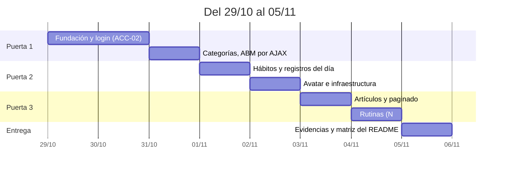

# Plan de cierre: qué se entrega el 05/11

Quedan **7 días de código** (29/10 al 04/11) y el 05/11 es solo entrega. Los 7 requisitos de la cátedra
cuestan ~52 h y hay 49 h: falta poco, pero falta. Por eso el plan abre con qué se hace cada día, y el
recorte se decide el 31/10, no el 04/11.

---

## 1. El plan, día por día

| Día | Fecha | Horas | Qué se hace | Se cierra |
| :--- | :--- | --: | :--- | :--- |
| 1 | jue 29/10 | 7 | Conexión MySQL y patrón de repositorio, contrato de errores de la API, DTOs. Endpoint de humo con un dato real | — |
| 2 | vie 30/10 | 7 | `ACC-02`: JWT, guard de rutas en la SPA, cliente HTTP con `Bearer`, shell con barra superior | `RT-07` |
| 3 | sáb 31/10 | 7 | `ACC-03` (logout) y `CAT-01`…`CAT-04`: el ABM completo por AJAX | **Puerta 1** · `RT-04` |
| 4 | dom 01/11 | 7 | `HAB-01`, `HAB-02` y `REG-01` (marcar el día) | — |
| 5 | lun 02/11 | 7 | `REG-04` (la semana de un vistazo), `PER-01` y `PER-02` (avatar + infra de archivos) | **Puerta 2** · `RT-02` |
| 6 | mar 03/11 | 7 | `ART-01` (portada, reusa la infra de archivos) y `ART-04` (catálogo con paginado de servidor) | `RT-03`, `RT-05` |
| 7 | mié 04/11 | 7 | `RUT-01` y `RUT-02`: la N:M y el buscador asíncrono de hábitos | **Puerta 3** · `RT-01`, `RT-06` |
| 8 | jue 05/11 | — | Capturas y GIF por requisito, matriz de evidencias en el README, DER en imagen, enlace | **Entrega** |

---

## 2. Las puertas

Tres cortes con fecha. Si una puerta no cierra, se aplica el recorte de §4 **ese mismo día**, no el 04/11.

### Puerta 1 — sábado 31/10

- [ ] `ACC-02`: login con `Bearer` funcionando de punta a punta, con el guard de la SPA activo.
- [ ] `ACC-03`: logout que invalida la sesión en el cliente.
- [ ] `CAT-01`…`CAT-04`: alta, edición, baja y listado por AJAX, sin recargar la página.

**Si no cierra:** se recorta producto, nunca arquitectura. Sin login no hay nada que entregar.

### Puerta 2 — lunes 02/11

- [ ] `HAB-01`, `HAB-02`: crear y ver hábitos.
- [ ] `REG-01`, `REG-04`: marcar el día y ver la semana.
- [ ] `PER-02`: avatar subido y visible en el perfil.

**Si no cierra:** se cae Artículos entero y el plan se replanifica a 5 de 7 requisitos (§4).

### Puerta 3 — miércoles 04/11

- [ ] `ART-01`: portada subida y guardada en `wwwroot/uploads/`.
- [ ] `ART-04`: catálogo paginado por servidor.
- [ ] `RUT-01`, `RUT-02`: rutina con hábitos asociados y buscador asíncrono.

**Si no cierra:** se cae Rutinas. Se entrega para regularizar con 5 de 7.

---

## 3. Qué cubre, y qué queda afuera

La consigna pide una **matriz de evidencias** en el README con siete puntos. La columna "historia mínima"
es lo más barato que los cierra de verdad —no lo que la propuesta prometió, sino lo que la cátedra exige:

| Requisito | Lo que pide la consigna | Historia mínima | Horas |
| :--- | :--- | :--- | --: |
| `RT-07` | Endpoints Web API con JWT, consumidos con `Bearer` | `ACC-02` | — (viene con la Fundación) |
| `RT-02` | Login/Logout, seguridad de roles, **una** funcionalidad restringida por rol, avatar | `ACC-02`, `ACC-03`, `CAT-*`, `PER-02` | — |
| `RT-04` | Un ABM completo por AJAX, sin recargar | `CAT-01` → `CAT-04` | 6 |
| `RT-03` | Archivos en el servidor, **adicional al avatar** | `ART-01` (portada) | 3 |
| `RT-05` | Paginado por servidor en los listados principales | `ART-04` | 4 |
| `RT-01` | 6 tablas relacionadas, con 1:N y **N:M** | `RUT-01`, `RUT-02` (la N:M `rutina_habito`) | 6 |
| `RT-06` | Búsqueda asíncrona de entidades relacionadas | `RUT-02` (buscador de hábitos) | — (misma historia) |

Tres correcciones que importan para el calendario:

- **`RT-02` no pide cambio de rol.** Pide login, logout, roles, una funcionalidad restringida y avatar.
  `HU-USU-04` es un requisito **propio** de Javito, no de la cátedra: ~2 h que quedan fuera.
- **`RT-05` no pide tres listados.** Pide que los listados principales estén paginados: si el único
  listado principal que se entrega es el catálogo, `ART-04` alcanza. Las tres listas son la vara de la
  [propuesta](./propuesta.md), más alta que la de la cátedra.
- **`RT-01` y `RT-06` los cierra el mismo módulo.** Rutinas son 6 h y pagan dos requisitos: el mejor
  retorno por hora del cronograma.

### La barra de cada condición

| Condición | Barra de la consigna | Requisitos |
| :--- | :--- | :--- |
| **Regularizar** | Matriz de evidencias completada hasta el estado actual, **al menos 70% de los puntos** | **5 de 7** |
| **Promocionar** | Todo al 100%, script SQL con datos y credenciales por rol | **7 de 7** |

Las dos piezas extra de promoción **ya están hechas**: `database.sql` trae datos de prueba y el README
documenta las credenciales de los cuatro usuarios. Promocionar no depende de trabajo extra: depende de
cerrar los 7.

El atajo que eso habilita, decidido de antemano: **si se cae Rutinas quedan 5 de 7 y la entrega regulariza
igual**. Es el único corte que no rompe nada del resto del sistema.

### Los números del producto

| Escenario | Historias | % de las 37 | Horas |
| :--- | --: | --: | --: |
| Los 7 requisitos, sin nada más | **16** | **43%** | ~52 |
| Los 7 requisitos + las 21 restantes | 37 | 100% | ~88 |

**El 70% de producto no entra.** Quedan afuera 21 de las 37 historias: `ACC-01`, `HAB-03`/`04`/`05`,
`REG-02`/`03`/`05`/`06`, `RUT-03`/`04`/`05`, `ART-02`/`03`/`05`, `HIS-01`/`02`, `USU-01`…`USU-05`.

---

## 4. El presupuesto, y la brecha

| Bloque | Historias | Horas |
| :--- | :--- | --: |
| Fundación + `ACC-02` | `ACC-02` | 12 |
| Acceso | `ACC-03` | 0.5 |
| Categorías (`RT-04`) | `CAT-01`…`04` | 6 |
| Hábitos | `HAB-01`, `02` | 5 |
| Registros | `REG-01`, `04` | 7 |
| Perfil (`RT-02`) | `PER-01`, `02` | 5 |
| Artículos: archivos (`RT-03`) | `ART-01` | 3 |
| Artículos: paginado (`RT-05`) | `ART-04` | 4 |
| Rutinas (`RT-01`, `RT-06`) | `RUT-01`, `02` | 6 |
| Evidencias del README | — | 4 |
| **Total** | **16** | **52.5** |
| **Disponible** (7 días × 7 h) | | **49** |
| **Brecha** | | **−3.5** |

Las horas son estimaciones, no mediciones. Dos palancas para cerrar la brecha, y hay que elegir una
**antes del 31/10**:

| Palanca | Qué cuesta | Qué gana |
| :--- | :--- | :--- |
| **A · Sábado y domingo a 8 h**, más 2 h el 05/11 | Menos descanso en el tramo medio | ~4 h · los 7 requisitos quedan al alcance |
| **B · Planificar a 5/7 y sacar Rutinas** | Se pierden `RT-01` y `RT-06`: no hay promoción | ~6 h de aire y entrega tranquila |

Recomendación: **ir por A hasta la Puerta 2**. Si el lunes 02/11 a la noche no cerró, se cambia a B en ese
momento y el miércoles se entrega para regularizar sin drama.

**Regla de corrección:** al cerrar cada día se anota lo hecho contra lo estimado. Una desviación de más
de 2 h obliga a recortar **ese mismo día**, por el final de la lista: primero `RUT-05`, después `ART-05`,
después Rutinas completa.

---

## 5. Las evidencias no son trámite

La matriz del README exige, por requisito, enlace al código **y** evidencia visual. Un requisito sin
captura es una fila que miente en la defensa:

| Requisito | Qué hay que capturar |
| :--- | :--- |
| `RT-01` | El DER y la tabla `rutina_habito` con filas |
| `RT-02` | Login, perfil con avatar visible, y Categorías abierta con rol `Usuario` devolviendo 403 |
| `RT-03` | Subida de una portada y el archivo en `wwwroot/uploads/` |
| `RT-04` | GIF del ABM de categorías completo, sin recargar |
| `RT-05` | Inspector de red mostrando `?pagina=2` y la respuesta con solo esa página |
| `RT-06` | GIF del buscador de hábitos filtrando mientras se escribe |
| `RT-07` | Postman o Bruno con `Bearer` devolviendo 200 y, sin el token, 401 |

Se graba **cuando el requisito se cierra**, no todo el 05/11: un GIF por puerta vale más que siete a las
23:00.

---

## 6. Riesgos con nombre propio

1. **La Fundación es la estimación menos confiable.** Doce horas para repositorios, contrato de errores,
   DTOs, JWT, guard y shell es optimista. Si el jueves a la noche no hay un endpoint devolviendo un dato
   real desde MySQL, la Puerta 1 se corre un día y se aplica §4 ese mismo jueves.
2. **Archivos tiene dos consumidores** (`PER-02` y `ART-01`) y una sola implementación válida: si la
   subida y la validación se escriben dos veces, se pierden 4 h y probablemente `RT-03`.
3. **El paginado también**: `ART-04` fija el helper. Escribirlo pensando en que después lo usen Historial
   y Usuarios no cuesta nada; reescribirlo cuesta 3 h.
4. **La defensa es después del cierre y solo para promocionar.** No hay que ensayar el 05/11: hay que
   entregar. Pero el README se lee en voz alta, así que la matriz se escribe para ser leída.

---

## Próximo paso

Abrir el issue del día 1 —la conexión a MySQL y el contrato de errores— y no escribir una línea de
Categorías hasta que haya un endpoint devolviendo un dato real.
