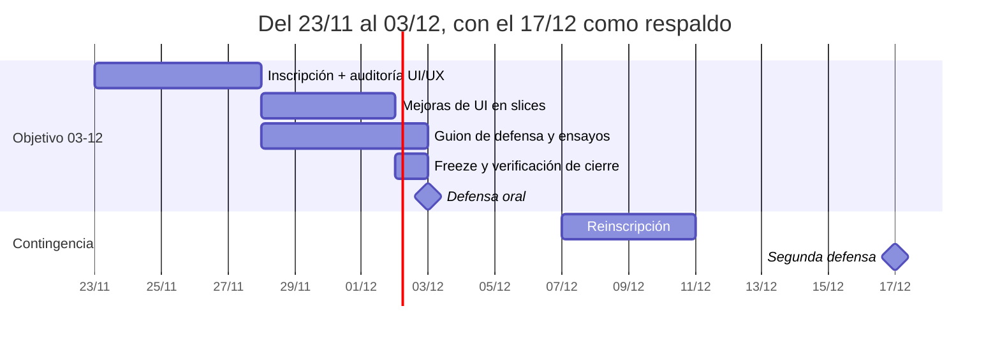

# Plan para la defensa · 03-12-2026

**Objetivo:** rendir la defensa oral el **jueves 03-12-2026**, con el **17-12-2026** como respaldo. El
proyecto está **funcionalmente completo**: los 7 requerimientos mínimos figuran como *Cumplido* en la
[matriz del README](../../README.md#matriz-de-evidencias-de-requerimientos-mínimos). Lo que queda son tres
cosas: una mejora importante de UI/UX, la verificación de cierre y la preparación de la defensa.

---

## 1. Decisiones

- **Apuntar al 03-12, no al 17-12.** El calendario ofrece dos ventanas de inscripción consecutivas
  (23–27/11 para el 03-12 y 07–10/12 para el 17-12): presentarse primero convierte al 17-12 en un
  **segundo disparo gratis**. Si algo sale mal, se pierde una fecha, no la materia.
- **"Mejora importante de UI/UX" ≠ rediseño.** No hay tiempo para rediseñar y no hace falta. Se auditan
  las pantallas que se muestran en la demo y se eligen **3–5 mejoras de alto impacto**: jerarquía visual,
  estados vacíos, feedback de las acciones y responsividad. Lo que no es visible en la defensa no se toca.

> **Regla de scope:** **ninguna mejora nueva entra después del 27-11.** Lo que no esté en la lista
> priorizada de la auditoría va a "si sobra tiempo antes del freeze"; y si no sobra, no existe.

---

## 2. El calendario en un gráfico

Los ensayos corren **en paralelo** con las mejoras de UI a propósito: el guion y la demo comparten la misma
estructura, así que ensayar mientras se pule la pantalla es más barato que hacerlo después.

---

## 3. Calendario día por día

| Bloque | Qué debe existir al cerrarlo | Verificación |
| :--- | :--- | :--- |
| **23–27/11** | La inscripción presentada y una **lista priorizada de 3–5 mejoras de UI** con la pantalla y el problema de cada una. | En la lista queda escrito el **scope congelado**: es el §1 de este doc y no se agranda. |
| **28/11–01/12** | Las mejoras ejecutadas en **slices chicos**, uno por commit, sin romper nada del resto. | `pnpm check` y `pnpm lint` en verde al cerrar **cada** slice. |
| **02/12 (freeze)** | Nada nuevo de producto. Verificación completa y capturas al día. | `pnpm check`, `pnpm test:e2e` y `pnpm db:reset` en verde; recorrido manual de **todos** los flujos como los verá el tribunal; capturas y GIF de `docs/evidencias/` regenerados si la UI cambió, y la matriz del README apuntando a evidencias que reflejan la UI actual. |
| **03/12** | La defensa oral, de **10 a 12 minutos**, con la demo ya ensayada. | El ensayo del 02/12 entra completo en el tiempo y no depende de la red ni de datos improvisados. |

---

## 4. Guion de la defensa

Cinco tramos, en este orden:

1. **Problema.** Qué falla en las apps de hábitos (fricción, dependencia del celular, cobros, interfaces
   saturadas) y qué propone Javito. Sale de la [propuesta](./propuesta.md).
2. **Demo guiada por historias de usuario.** Se recorre la app con las
   [historias](./historias-de-usuario.md) como guion, no con un listado de pantallas: marcar el día,
   la semana de un vistazo, el ABM de categorías sin recargar, la portada del artículo, el catálogo
   paginado y el buscador de hábitos de una rutina.
3. **Arquitectura.** SPA en SvelteKit + Web API en ASP.NET Core + MySQL; **ADO.NET puro sin ORM**
   (`Repositorios/` con `MySqlConnector`); **`ProblemDetails`** con un `codigo` estable que el cliente
   interpreta, nunca el texto; **JWT con roles**; validación de imágenes por **firma** del archivo; y
   **paginado y búsqueda asíncrona resueltos en el servidor**.
4. **Matriz de evidencias.** Recorrido del README, requerimiento por requerimiento.
5. **Límites del alcance.** Lo que el sistema no es: sin offline, sin app móvil nativa, sin calendarios
   externos, sin notificaciones push.

**Regla de la defensa:** cada afirmación cita la **línea de código exacta** de la matriz del README. Si no
hay enlace, no se dice.

---

## 5. Preguntas probables del tribunal

| Pregunta | Respuesta en una línea | Archivo que la respalda |
| :--- | :--- | :--- |
| ¿Por qué ADO.NET en vez de EF Core? | SQL escrito a mano y parametrizado: control total de las consultas y cero magia en el mapeo. | `backend/Javito.Api/Repositorios/` (`MySqlConnector`) |
| ¿Cómo se autorizan los roles? | El token lleva el rol y se valida con `RoleClaimType = "rol"` más `[Authorize(Roles = ...)]`. | `backend/Javito.Api/Seguridad/Roles.cs`, `Program.cs`, `Controllers/` |
| ¿Por qué baja lógica y no `DELETE`? | Porque el historial y los registros deben sobrevivir a la baja: se cambia `activo`/`estado`. | `database.sql` |
| ¿Cómo se valida una imagen subida? | Por la **firma** del archivo, no por la extensión ni el `Content-Type`: un HTML renombrado nunca llega al disco. | `backend/Javito.Api/Archivos/FirmasDeImagen.cs` |
| ¿Qué pasa si dos usuarios crean la misma categoría a la vez? | El índice `UNIQUE` del esquema lo impide; la carrera devuelve 500 pero nunca guarda un duplicado. | `database.sql` |

**Si una respuesta no puede señalar código, no está en la defensa.**

---

## Log

- **L1** — Pedido del usuario: *"Dejemos sentado en un doc este plan, adjunto con un diagrama gantt muy
  simple así me guío visualmente rápido y sencillo. Actualizá el doc desactualizado que dijiste antes."*
- **Decisión:** fecha objetivo **03-12**, elegida el 23-11 en conversación con el usuario (opción
  "03-12 (inscribir antes del 27-11)").
